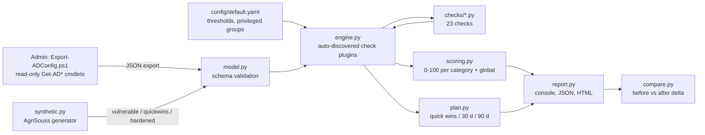

# ad-security-audit: offline Active Directory configuration audit

An offline auditor for an **Active Directory configuration export (JSON)**, in the spirit of
PingCastle and the ANSSI "points de contrôle Active Directory". It reads the export, runs
**23 configuration checks**, computes a **0-100 risk score (lower is better)**, explains each
finding with its references, and produces a **prioritised remediation plan** (quick wins /
30 days / 90 days) as console text, JSON and a standalone HTML report. A compare mode shows
the score delta between two exports (before / after remediation).

> **Defensive scope.** Configuration review only: no network access, no connection to a
> domain controller, no credential handling, no attack tooling. Risks are explained at a
> high level with detection and remediation guidance. All data shipped in this repository is
> **synthetic** (fictional SME *AgriSouss SARL*, domain `agrisouss.local`).

## Résumé (FR)

Outil Python qui audite **hors ligne** un export JSON de la configuration d'un domaine
Active Directory, comme une mini version de PingCastle ou de la checklist ANSSI. 23 contrôles
(politique de mots de passe, comptes à privilèges, Kerberos, délégation, krbtgt, LAPS, OS
obsolètes, SMB/LLMNR/NTLM, approbations), un score de risque de 0 à 100 (plus bas = mieux),
un rapport HTML autonome en français et un plan de remédiation priorisé. Les données fournies
sont **synthétiques** (entreprise fictive AgriSouss SARL). Score : **90/100** sur l'export
vulnérable, **74** après les quick wins, **0** sur l'export durci. Aucune instruction
d'exploitation : uniquement détection et remédiation.

## Quick start

```bash
pip install -r requirements.txt          # PyYAML + pytest, Python 3.11
python -m adaudit list-checks
python -m adaudit audit data/agrisouss_vulnerable.json --html reports/vulnerable.html --json reports/vulnerable.json
python -m adaudit compare data/agrisouss_vulnerable.json data/agrisouss_hardened.json --html reports/compare.html
python -m adaudit audit my-export.json --fail-on high   # exit 1 if a high/critical finding exists (CI)
python -m pytest
```

Exit codes: `0` OK, `1` findings at or above `--fail-on`, `2` invalid export or config.
Thresholds live in `config/default.yaml` (override with `--config my.yaml`).

## Architecture



| Path | Role |
|---|---|
| `adaudit/model.py` | loads and validates the export (types, required fields, duplicates, size, UTF-8/BOM); cycle-safe iterative group expansion |
| `adaudit/engine.py` | `Check` base class, `@register` decorator, plugin discovery, `Finding` |
| `adaudit/checks/` | one class per check, grouped by theme |
| `adaudit/scoring.py`, `plan.py` | score formula ([docs/SCORING.md](docs/SCORING.md)) and remediation buckets |
| `adaudit/report.py`, `compare.py` | renderers; HTML is escaped, no script, no external resource, strict CSP |
| `adaudit/synthetic.py` | deterministic AgriSouss exports; hardened = vulnerable + one fix per check |
| `tools/Export-ADConfig.ps1` | read-only export script for a real domain (not tested on a live domain) |
| `docs/` | [SCHEMA.md](docs/SCHEMA.md), [EXPORT.md](docs/EXPORT.md), [SCORING.md](docs/SCORING.md) |

## Checks

References: **ANSSI** IDs are those of the ANSSI / CERT-FR *Points de contrôle Active
Directory* (cert.ssi.gouv.fr/uploads/ad_checklist.html, read 2026-10-03). **CIS** = CIS
Microsoft Windows Server Benchmark (setting name only: section numbers change between
versions). **ATT&CK** IDs and names were checked against MITRE ATT&CK **v19.2** on
2026-10-03; they describe what the misconfiguration makes easier, not how to do it.

| ID | Severity | Check | Main reference | ATT&CK |
|---|---|---|---|---|
| AD-PWD-001 | high | Weak domain password policy (length, complexity, history, reversible) | ANSSI password guide 2021, CIS Password Policy | T1110.001, T1110.003 |
| AD-PWD-002 | high | No / permissive account lockout | CIS Account Lockout, MS baseline | T1110.001, T1110.003 |
| AD-PRIV-001 | high | Too many effective Domain Admins (nested included) | ANSSI vuln_privileged_members | T1078.002 |
| AD-PRIV-002 | medium | Non-default groups nested in privileged groups | ANSSI vuln_privileged_members | T1078.002 |
| AD-PRIV-003 | high | Privileged accounts outside Protected Users / delegable | ANSSI vuln_protected_users | T1550.003, T1550.002 |
| AD-PRIV-004 | medium | Privileged accounts with password never expires | ANSSI vuln_dont_expire_priv | T1078.002 |
| AD-PRIV-005 | low | adminCount=1 orphans (AdminSDHolder leftovers) | Microsoft AdminSDHolder/SDProp | none (hygiene) |
| AD-PRIV-006 | critical | Service accounts (SPN) in privileged groups | ANSSI vuln_spn_priv | T1558.003 |
| AD-PRIV-007 | low | Group nesting loops | ANSSI vuln_group_loop | none |
| AD-ACC-001 | medium | Enabled accounts unused for > 180 days | ANSSI vuln_user_accounts_dormant | T1078.002 |
| AD-ACC-002 | high | Built-in Guest enabled | ANSSI vuln_guest | T1078.001 |
| AD-ACC-003 | high | Password hint in description (flagged, value masked) | Microsoft: description readable by all users | T1552 |
| AD-ACC-004 | medium | PASSWD_NOTREQD flag | Microsoft userAccountControl | T1078.002 |
| AD-KRB-001 | high | Kerberos pre-authentication disabled | ANSSI vuln_kerberos_properties_preauth(_priv) | T1558.004 |
| AD-KRB-002 | high | SPN accounts with old passwords (recommend gMSA) | Microsoft gMSA, ANSSI vuln_kerberos_properties_encryption | T1558.003 |
| AD-KRB-003 | critical | Unconstrained delegation outside DCs | ANSSI vuln_delegation_t4d | T1558, T1550.003 |
| AD-KRB-004 | high | krbtgt secret older than 180 days | ANSSI vuln_krbtgt (> 1 year) | T1558.001 |
| AD-INF-001 | high | LAPS not deployed / coverage < 95 % | Microsoft Windows LAPS, CIS LAPS | T1078.003, T1550.002 |
| AD-INF-002 | high | Out-of-support OS (DCs tagged) | ANSSI vuln_dc_obsolete, MS Lifecycle | T1210 |
| AD-INF-003 | medium | SMB signing not required | CIS "Digitally sign communications (always)" | T1557.001 |
| AD-INF-004 | medium | LLMNR / NetBIOS-NS enabled | CIS "Turn off multicast name resolution" | T1557.001 |
| AD-INF-005 | high | LM / NTLMv1 accepted (LmCompatibilityLevel < 5) | CIS "LAN Manager authentication level" | T1557.001, T1550.002 |
| AD-TRU-001 | high | Trust without SID filtering | ANSSI vuln_trusts_domain_notfiltered | T1134.005, T1484.002 |

Every finding carries: id, title, severity, category, effort bucket, evidence, why it
matters, remediation, references, ATT&CK mapping. Adding a check = one class with
`@register` in `adaudit/checks/` plus a mutation in `tests/test_checks.py`.

## Results (synthetic data)

| Export | Global score | Findings |
|---|---|---|
| `agrisouss_vulnerable.json` | **90 / 100** (critique) | 23 (2 critical, 13 high, 6 medium, 2 low) |
| `agrisouss_quickwins.json` | **74 / 100** (élevé) | 14 |
| `agrisouss_hardened.json` | **0 / 100** (faible) | 0 |

Sample reports are in `reports/`. Tests: **174 passed** (`python -m pytest`), covering:
each check fires on the vulnerable export and is silent on the hardened one; each check is
triggered alone by one mutation of a clean minimal export; boundaries; scoring; CLI and exit
codes; 25+ malformed-input cases; HTML escaping of hostile values; planted fake secrets never
appear in any output; generator determinism.

## Limits (honest)

- Audits an **export**, not a live domain: the result is only as good as the export, and
  `gpoSummary` is filled by hand.
- No ACL / attack-path analysis (BloodHound-style), no ADCS, no Fine-Grained Password
  Policies, no RODC, no Azure AD / Entra ID. PingCastle covers far more.
- `trustedToAuthForDelegation` (constrained delegation with protocol transition) is
  exported but not checked yet.
- OS obsolescence is a name-substring match (Windows 10 flagged since 2025-10-14 unless LTSC;
  paid ESU is not visible in AD).
- The PowerShell export script is syntax-checked only; never run on a real domain.
- Scoring weights are a documented design choice, not an industry standard.

## License

MIT, see [LICENSE](LICENSE). Author: Mohamed Elansari (student project, built with AI
assistance, reviewed and tested by the author).
